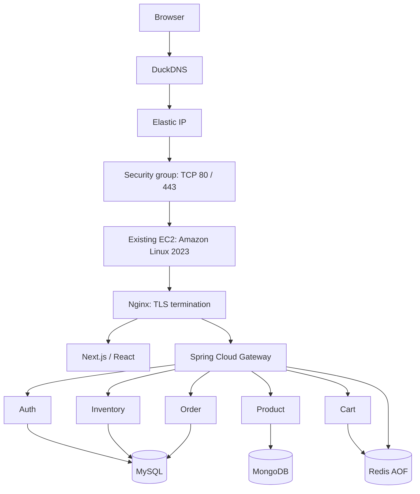
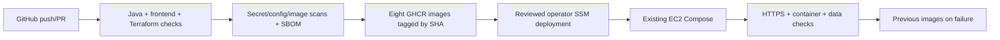
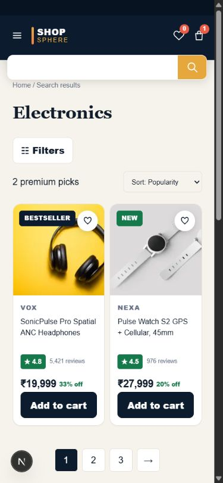

# ShopSphere

ShopSphere is a portfolio e-commerce application operated on an existing AWS EC2 instance. It demonstrates customer authentication, product discovery, carts, inventory-aware checkout and persistent orders, together with deployment, monitoring, recovery and security work. Payments are simulated; the deployment uses a single host.

**Demo:** [shopsphere-sakti.duckdns.org](https://shopsphere-sakti.duckdns.org)

## Architecture



| Component | Responsibility |
|---|---|
| Auth | Registration, login, profile, password and address management |
| Product | Catalog, search/autocomplete, categories, details, reviews and wishlist |
| Inventory | Available/reserved stock and stock checks |
| Cart | User-owned cart, quantities and server-calculated prices |
| Order | Checkout, coupons, order history and durable idempotency |
| Gateway | API routing, JWT/role enforcement, limits and correlation IDs |

Java 21/Spring Boot services use MySQL/Flyway, MongoDB and Redis. The frontend uses Next.js, React and TypeScript. Docker Compose runs eleven application/data containers; Prometheus, Grafana and Node Exporter bring the current total to fourteen. Databases use persistent named volumes.

## AWS and HTTPS

The existing ap-south-1 deployment uses m7i-flex.large, encrypted 40 GiB gp3 EBS, IMDSv2, SSM and an Elastic IP. Only TCP 80/443 are public. Nginx redirects HTTP to trusted Let's Encrypt HTTPS while retaining HTTP-01 challenges. Renewal uses a host timer and persistent, ignored certificate directories.

Terraform records VPC/subnet/routes, IAM/SSM, EC2, EIP and web ingress. The AMI is pinned to prevent lookup drift. Supply repository_ref separately as a reviewed SHA; changing bootstrap inputs can still require replacement, so inspect every plan. Routine image deployment does not run Terraform.

EC2, EBS and public IPv4 are cost-sensitive. Stopping EC2 does not remove storage or allocated IPv4 costs. No EKS, RDS, ALB, NAT Gateway, CloudFront, WAF or Route53 hosted zone was added.

## Delivery and security



[CI run 34101039768](https://github.com/sakti69-cssoft/ShopSphere-Cloud-Native-ECommerce/actions/runs/34101039768) passed, including all eight image gates. Images from 5d3259f were deployed through SSM and verified healthy. The approval-gated GitHub OIDC workflow is configured but still needs external IAM/Environment setup; successful automated OIDC deployment is not claimed.

Trivy blocks fixable HIGH/CRITICAL image findings. Phase 8 patched runtime Alpine packages, upgraded embedded Tomcat to 10.1.59 and removed unused runtime npm. Application containers are non-root with reduced privileges. A host metrics timer replaced privileged cAdvisor; monitoring containers do not mount the Docker socket. Secrets, certificates, backups, Terraform state and plans remain outside Git.

## Monitoring and recovery

Seven Prometheus scrape targets and twelve rules cover host, JVM, API and container health. Five provisioned Grafana dashboards cover overview, host, containers, JVM and HTTP. Prometheus/Grafana bind to loopback; use an SSM tunnel. External alert delivery, tracing and centralized logs are not configured.

Backup scripts create compressed, restricted MySQL/MongoDB archives with retention and content fingerprints. An isolated restore verified three MySQL databases/eleven tables and three MongoDB collections/43 documents, including record fingerprints. Local backups share the EBS failure domain; off-host storage remains a future improvement. Redis AOF persists carts subject to their intended expiry.

## Local development

Use Docker with Compose, or Java 21/Maven and Node.js 22 for host checks. Copy .env.example only when no local .env exists, then fill local secrets without committing them.

```powershell
docker compose --profile local config --quiet
docker compose --profile local up -d --build --wait
cd frontend
npm ci
npm run dev
```

The local frontend is http://localhost:3000. CI runs lint, type checks, frontend build, Java suites, Compose checks and Terraform validation. See the runbooks before operating production. Never use docker compose down -v for a restart.

## Evidence and limitations

The [phase ledger](docs/DEVOPS-PHASE-STATUS.md) records checks, commits and remaining work. Phase 8 verified fourteen healthy containers, HTTPS 200, unchanged database mounts and counts of 41 products, 41 inventory records, eleven users and two orders. These are dated evidence, not continuous workflow certification.

Limitations include simulated payments, one host/failure domain, shared JWT secrets, browser-held refresh tokens, MongoDB administrator credentials in the demo connection, best-effort reservation compensation, local-only backups and incomplete OIDC deployment setup. New managed infrastructure requires review.

## Documentation

- [Architecture](docs/ARCHITECTURE.md) and [deployment](docs/DEPLOYMENT.md)
- [Production operations](docs/PRODUCTION-OPERATIONS-RUNBOOK.md)
- [CI/CD](docs/CICD.md), [monitoring](docs/MONITORING.md), [security](docs/SECURITY.md)
- [Backup/recovery](docs/BACKUP-RECOVERY.md) and [troubleshooting labs](docs/TROUBLESHOOTING-LABS.md)
- [Interview package](docs/interview/SHOPSPHERE-INTERVIEW-GUIDE.md)
- [Order idempotency](docs/order-idempotency.md) and [frontend integration](docs/frontend-backend-integration.md)

Existing UI examples (historical screenshots):



