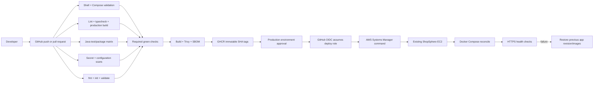

# ShopSphere CI/CD

ShopSphere separates continuous integration, immutable image publication, and production deployment. Pull requests run validation only. A push to `main` runs the same gates and then attempts to publish eight revision-tagged images. Production deployment is a separate, manual, GitHub Environment-protected workflow that uses short-lived AWS credentials and SSM—never public SSH.



## Workflows

### Continuous integration

`.github/workflows/ci.yml` runs on pull requests, `main` pushes, and manual dispatch. It performs:

1. Shell syntax and production Compose model validation.
2. Frontend `npm ci`, ESLint, production build, and TypeScript checks on Node 22.
3. Maven test/package for Gateway and five services on Java 21. Test reports are retained even on failure.
4. Reusable repository secret/configuration scans.
5. Reusable Terraform format/init/validate checks; no plan/apply in GitHub Actions.
6. On a `main` push only, image build, vulnerability gate, CycloneDX SBOM upload, and GHCR publication.

The Compose check uses `.env.production.example` and `config --quiet`, so it validates required variables and mounts without printing expanded secrets.

### Image publication

`.github/workflows/docker-publish.yml` builds these images:

- `auth-service`, `product-service`, `inventory-service`, `cart-service`, `order-service`
- `gateway`, `frontend`, `nginx`

Each image is tagged `ghcr.io/OWNER/shopsphere-SERVICE:<full-git-sha>`. Trivy scans the exact built image before registry login/push, and an SBOM is uploaded. `latest` is convenience metadata; production deploys only the immutable SHA.

The initial image gate blocked publication. Phase 8 fixed the observed findings;
CI run 34101039768 passed all checks and published all eight images at `5d3259f`.
Those images were deployed through a reviewed operator SSM command and verified
healthy on 2026-09-07. The GitHub OIDC deployment workflow remains configuration
only until its IAM role and Environment are set up and exercised.

The production checkout contains historical reviewed local modifications.
Do not invoke the checkout-based deploy script blindly: first reconcile those
changes. The verified Phase 8 operator deployment recorded each previous image,
preserved environment/TLS/data, and changed only the eight application containers.

### Production deployment

`.github/workflows/deploy-production.yml` is manual (`workflow_dispatch`) and requires an exact 40-character SHA already on `origin/main`. The job targets GitHub Environment `production`, allowing repository administrators to require reviewers. It assumes an AWS role with OpenID Connect, confirms the existing instance is SSM Online, and sends an SSM command only to `i-0e2cf0109097385b1`.

On the instance, `scripts/deploy-production-revision.sh`:

1. Refuses a dirty tracked checkout, invalid SHA/owner/URL, missing production environment, or a revision not on `origin/main`.
2. Records the previous Git revision and derives the running immutable image owner/tag without reading secrets.
3. Preserves `.env.production`, TLS runtime files, and named MySQL/MongoDB/Redis volumes.
4. Checks out the exact approved revision in detached mode.
5. Validates Compose, pulls the approved SHA images, and runs `docker compose up -d --wait`.
6. Runs `nginx -t` and verifies `/`, `/nginx-health`, and `/api/v1/products` through public HTTPS.
7. If reconciliation or health fails, restores the previous source revision and running image revision, then repeats Compose and health verification.

It never invokes Terraform, public SSH, `docker compose down`, or volume deletion. Rollback is application-only: it never rolls database data backward. Backward-incompatible Flyway migrations require a reviewed forward fix or separate recovery decision.

## Required one-time GitHub/AWS configuration

These external controls must be configured by an account/repository administrator before the workflow can deploy. They are intentionally not created automatically:

1. Create GitHub Environment `production`; add required reviewers and restrict it to `main`.
2. Create an AWS IAM OIDC provider for `https://token.actions.githubusercontent.com` if the account does not already have one.
3. Create a narrowly scoped role whose trust policy restricts `sub` to the repository's `production` environment.
4. Grant only the SSM actions needed to target the existing instance/document plus read command results.
5. Save only the role ARN as environment secret `AWS_DEPLOY_ROLE_ARN`. An ARN is an identifier, not an AWS secret key.
6. Keep GHCR packages readable by the instance, or configure a mode-restricted registry credential on the instance outside Git. Do not put a personal access token in the workflow command.

Example trust-policy condition (replace account/provider values during reviewed IAM setup):

```json
{
  "Condition": {
    "StringEquals": {
      "token.actions.githubusercontent.com:aud": "sts.amazonaws.com",
      "token.actions.githubusercontent.com:sub": "repo:sakti69-cssoft/ShopSphere-Cloud-Native-ECommerce:environment:production"
    }
  }
}
```

Recommended deploy-role permissions are `ssm:SendCommand` scoped to the existing instance and `AWS-RunShellScript` document, `ssm:GetCommandInvocation` for results, and the identity/read calls used by the workflow. Do not attach administrator access and do not store long-lived AWS access keys in GitHub.

## Operator procedure

1. Confirm the CI run for the chosen `main` SHA is fully green and all eight SHA images exist.
2. Review database migration compatibility and current backup status.
3. Open **Actions → Deploy production via SSM → Run workflow**.
4. Enter the exact full SHA and obtain the `production` environment approval.
5. Monitor the SSM output and final public health step. Output intentionally contains no environment values.
6. Verify application functionality and persistent data after deployment.

Manual host fallback remains available through SSM:

```bash
cd /opt/shopsphere
bash scripts/deploy-production-revision.sh FULL_40_CHARACTER_SHA sakti69-cssoft https://shopsphere-sakti.duckdns.org
```

Use that only after the same CI/image checks. Never use `docker compose down -v`.

## Rollback behavior and limitations

Rollback uses the exact previously running image owner/tag and prior Git revision recorded under ignored `.deploy-state/`. Existing images and volumes are not pruned. If a new image cannot be pulled, containers are not reconciled and the prior checkout is restored. If new containers fail health, Compose returns to the prior image set and verifies the old public release.

Rollback cannot safely undo a destructive schema migration. Migrations must remain backward-compatible across one release window; otherwise stop deployment and execute the backup/recovery decision process. A failed rollback or unavailable database is an incident, not permission to reinitialize a volume.

## Security properties

- No public TCP 22 rule and no SSH key distribution.
- Short-lived GitHub OIDC credentials instead of stored AWS access keys.
- Manual Environment approval and serialized production deployments.
- Exact main-branch SHA validation and immutable image tags.
- Instance-scoped SSM target and no Terraform operation.
- Secrets stay in the mode-restricted EC2 environment file; the workflow never prints it.
- TLS/private-key runtime paths and deployment state remain Git-ignored.
