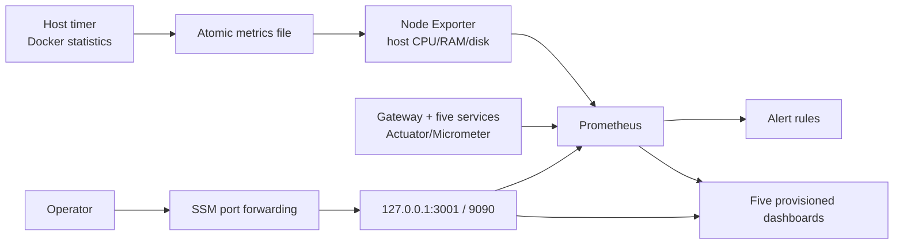

# ShopSphere Monitoring and Observability

ShopSphere runs Prometheus, Grafana and Node Exporter on the existing EC2 host.
Prometheus and Grafana bind only to loopback. Node Exporter is reachable only on
the private Docker network. A systemd timer collects selected Docker statistics
on the host and atomically writes a metrics file for Node Exporter; collector
containers do not receive the Docker socket.

## Capacity decision

The 2026-09-06 pre-deployment audit measured:

- EC2: `m7i-flex.large`, 7.6 GiB RAM.
- Memory: about 2.3 GiB used and 5.1 GiB available.
- Root disk: 40 GiB, about 7.8 GiB used and 33 GiB available.
- Load averages: approximately 0.20 / 0.24 / 0.38.
- Eleven application/data containers healthy.

The monitoring profile limits total 1.25 vCPU and 1 GiB RAM; these are ceilings,
not reservations. Prometheus retains seven days. Re-check resource consumption
after deployment. Removing cAdvisor reduces the steady-state total to fourteen
containers: eleven application/data containers and three monitoring containers.

## Architecture



Scrape targets:

- `shopsphere`: Gateway and five Java services at `/actuator/prometheus`.
- `node`: Node Exporter for CPU, memory, load, filesystem, and network.
- Node Exporter's textfile collector adds CPU, memory, restart count, uptime and
  health for containers bearing the ShopSphere Compose project label.

Application Actuator endpoints are not routed by public Nginx. Exporter ports are not published. Grafana `3001` and Prometheus `9090` bind to `127.0.0.1` only.

## Images and containment

- Prometheus: `prom/prometheus:v3.5.0`
- Grafana: `grafana/grafana:12.1.1`
- Node Exporter: `quay.io/prometheus/node-exporter:v1.12.1`

All versions are explicit. Prometheus, Grafana, and Node Exporter drop all capabilities and enable `no-new-privileges`. Node Exporter mounts the host root read-only and excludes noisy container filesystems.

cAdvisor was removed after review found that its privileged `/var/run` mount
exposed the Docker socket. Read-only bind mounts do not restrict socket API
operations. Its replacement is a root-owned host timer, constrained with a
read-only filesystem, explicit metrics write directory, private temporary
directory, and Unix sockets only. It queries selected state/statistics fields,
never container environments or healthcheck output. Node Exporter's read-only
host view masks `/host/run` with an empty tmpfs to hide host runtime sockets.

The timer runs every thirty seconds. On collection failure it preserves the
previous complete metrics file; a freshness alert detects stale data. Docker
stats memory values are rounded and CPU is an instantaneous percentage, not a
cumulative CPU counter. Per-container network/disk rates are no longer reported.

## Start or update monitoring

Install `scripts/collect-container-metrics.py` and the two units in
`monitoring/systemd/` as root-owned files. Provision
`/opt/shopsphere/runtime/metrics` as mode 0755, copy units to
`/etc/systemd/system`, run `systemctl daemon-reload`, then enable/start
`shopsphere-container-metrics.timer` and start the service once. Check successful
collection before updating Node Exporter. During migration remove only the
retired `shopsphere-prod-cadvisor-1` container after inspecting its name and
Compose project label; do not use global orphan removal or volume deletion.

Run through SSM from `/opt/shopsphere`. Never print the environment file.

```bash
test -s .env.production
docker compose \
  --env-file .env.production \
  -f compose.prod.yaml \
  -f compose.observability.yaml \
  --profile observability \
  config --quiet

docker compose \
  --env-file .env.production \
  -f compose.prod.yaml \
  -f compose.observability.yaml \
  --profile observability \
  up -d --wait prometheus grafana node-exporter
```

The production environment must contain a strong `GRAFANA_ADMIN_PASSWORD`. Do not echo it, commit it, or pass it on a command line. If it is absent, generate it directly on the instance and store it mode `0600` before starting Grafana.

The command creates only local Docker monitoring containers and named data volumes. It does not restart MySQL, MongoDB, Redis, or application containers.

## Secure operator access

Use SSM port forwarding rather than a public Grafana rule:

```bash
aws ssm start-session \
  --target i-0e2cf0109097385b1 \
  --document-name AWS-StartPortForwardingSession \
  --parameters '{"portNumber":["3001"],"localPortNumber":["3001"]}' \
  --profile shopsphere \
  --region ap-south-1
```

Open `http://127.0.0.1:3001` locally and authenticate with the instance-stored Grafana administrator credential. Use the same pattern with port `9090` only for Prometheus troubleshooting. Do not add security-group ingress for 3000, 3001, 8080–8085, 9090, or 9100.

## Dashboards

Grafana provisions five dashboards from version-controlled JSON:

1. **ShopSphere Overview** — service availability, request rate, p95 latency, Gateway routes, heap, threads, CPU, 5xx, and circuit breakers.
2. **ShopSphere Host / EC2** — host CPU, memory, root disk, load, and network.
3. **ShopSphere Containers** — per-container CPU, memory/limit, uptime, network, and filesystem writes.
4. **ShopSphere JVM / Microservices** — heap utilization, threads, process CPU, GC pauses, classes, and uptime.
5. **ShopSphere HTTP / API** — throughput, 5xx ratio, p95 latency, status codes, Gateway routes, and circuit breakers.

Empty rate panels immediately after startup are normal; generate representative requests and wait for at least two scrape intervals.

## Alert rules

Prometheus evaluates rules every 15 seconds:

| Alert | Condition | Purpose |
|---|---|---|
| `ServiceUnavailable` | Java scrape target down for 2 minutes | Detect service/metrics endpoint loss |
| `HighErrorRate` | HTTP 5xx ratio over 5% for 5 minutes | RED error signal |
| `HighLatency` | p95 over 2 seconds for 5 minutes | RED latency signal |
| `HighJvmHeap` | heap over 85% for 10 minutes | JVM pressure |
| `GatewayFailureSpike` | downstream 5xx over 1/sec | Edge dependency issue |
| `HostHighCpu` | CPU busy over 85% for 10 minutes | USE saturation signal |
| `HostHighMemory` | memory used over 85% for 10 minutes | OOM risk |
| `HostLowDisk` | root free space below 15% for 10 minutes | Database/build write risk |
| `ContainerHighMemory` | working set over 90% of limit for 10 minutes | Container limit risk |
| `MonitoringTargetUnavailable` | Node Exporter down for 2 minutes | Telemetry blind spot |
| `ContainerMetricsStale` | metrics file missing or older than 120 seconds | Host timer failure |
| `ContainerUnhealthy` | container health fails for 2 minutes | Includes database health |

These thresholds are initial portfolio values, not proven SLOs. Tune them using observed production traffic.

No Alertmanager receiver is configured because no approved email/Slack/PagerDuty credential exists. Rules still appear in Prometheus/Grafana. Adding notifications requires a separately provided destination secret stored outside Git.

## Validation

```bash
docker compose --env-file .env.production -f compose.prod.yaml -f compose.observability.yaml --profile observability ps
curl -fsS http://127.0.0.1:9090/-/healthy
curl -fsS http://127.0.0.1:3001/api/health
curl -fsS http://127.0.0.1:9090/api/v1/targets
curl -fsS http://127.0.0.1:9090/api/v1/rules
docker stats --no-stream
df -h /
free -h
```

Healthy means all three monitoring containers are healthy, all seven scrape
targets are up, twelve rules load, and the eleven application/data containers
remain healthy. Also check `systemctl status shopsphere-container-metrics.timer`
and the `shopsphere_container_metrics_timestamp_seconds` metric.

The first production scrape audit found Product Service returning HTTP 401 for its internal Prometheus endpoint while its health and customer APIs remained healthy. Its security allow-list now permits only `/actuator/health` and `/actuator/prometheus` without a JWT; public Nginx still does not route either Actuator path. After the targeted Product Service rebuild, all eight Prometheus targets must report `up`.

## Troubleshooting

- **Prometheus target down:** check Docker DNS/network, target container health, and the internal Actuator/exporter endpoint.
- **Grafana panel empty:** confirm datasource health, query labels, time range, and at least two scrapes.
- **High host memory:** identify consumers with `docker stats --no-stream`; do not restart databases blindly.
- **Low disk:** inspect Prometheus retention and Docker image/log usage. Never delete database volumes.
- **Container telemetry stale:** inspect the timer/service journal; confirm Docker is active and the metrics directory is writable by the host collector.
- **Alert not firing:** verify the expression in Prometheus, rule state, `for` duration, and metric labels.

Prometheus and Grafana data use separate named volumes. Their loss would remove monitoring history/dashboards state, not ShopSphere business data; provisioned dashboards remain in Git.

## Current limitations

- Single-host monitoring shares failure and resource domains with the application.
- No external Alertmanager notification destination.
- No distributed tracing or centralized long-term logs.
- Seven-day local Prometheus retention is not disaster recovery.
- The root host collector needs Docker administration access; keep its script and unit files root-owned and not writable by application containers.
- EC2 stop pauses all monitoring until the host restarts; restart policies restore containers when monitoring has previously been deployed.
