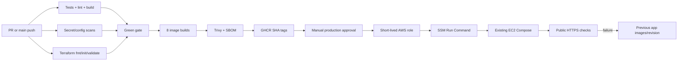

# ShopSphere CI/CD Interview Q&A

## What is the difference between CI, continuous delivery, and continuous deployment?

CI integrates changes through repeatable builds, tests, linting, and security/IaC gates. Continuous delivery keeps a verified artifact deployable but requires an intentional release decision. Continuous deployment automatically releases every passing change. ShopSphere implements CI and source-configures approval-gated delivery; it does not claim unattended continuous deployment.

## Describe the ShopSphere pipeline

Pull requests and `main` pushes run repository/Compose validation, frontend Node 22 checks, a Java 21 Maven matrix for Gateway plus five services, reusable security scanning, and Terraform source validation. A passing `main` build proceeds to eight application/proxy image builds, scans each image for HIGH/CRITICAL vulnerabilities, creates a CycloneDX SBOM, and is designed to publish full-SHA tags to GHCR. Production is a separate manual workflow requiring an exact SHA, GitHub Environment approval, OIDC role assumption, SSM delivery to the existing EC2, Compose health, public HTTPS checks, and rollback.

## What is the current verified pipeline status?

Verified on 2026-09-07: CI run 34101039768 passed and published all eight scanned images at 5d3259f; those images were deployed through operator SSM. All fourteen containers were healthy, seven Prometheus targets were up and twelve rules were loaded. The GitHub OIDC deployment workflow still requires external IAM/Environment setup.

## Why separate image publication from production deployment?

Build once, verify once, then promote the same immutable artifact. Separation prevents a production host from compiling arbitrary source, makes vulnerability/SBOM evidence belong to the exact image, and lets approval happen after CI. It also prevents a push to `main` from silently changing production.

## Why use full Git SHA tags?

A full SHA uniquely maps an image to source and avoids mutable-tag ambiguity. The deploy input must match a 40-character commit on `origin/main`, and the production Compose `IMAGE_TAG` selects it. `latest` can be published for convenience but is not the release identity.

## Why scan before login/push?

The image workflow builds and loads the image, runs the HIGH/CRITICAL Trivy gate, and generates an SBOM before registry publication. A vulnerable artifact therefore fails before being promoted. This is exactly what happened in the recorded Phase 5 run: the red gate prevented publication rather than being waived invisibly.

## What is an SBOM?

A Software Bill of Materials inventories components in an artifact. ShopSphere generates CycloneDX JSON per image and uploads it as a workflow artifact. It improves dependency visibility and incident response; it does not prove the absence of vulnerabilities or malicious build input.

## How is production approval controlled?

The deployment workflow is `workflow_dispatch` with an exact revision input and targets the GitHub `production` Environment. Repository administrators can configure required reviewers and protection rules. The workflow also serializes production with a concurrency group and does not cancel a deployment in progress. These controls require GitHub-side setup, which must be verified rather than assumed from YAML.

## How does OIDC work?

GitHub issues a short-lived identity token to the workflow. AWS validates it against an IAM role trust policy restricted to the intended repository/ref/environment, then issues temporary role credentials. This removes stored long-lived AWS access keys. ShopSphere's YAML requests `id-token: write` and references `AWS_DEPLOY_ROLE_ARN`; the role/trust and actual assumption have not yet been proven for this repository.

## Why deploy through SSM?

SSM targets the fixed existing instance without exposing SSH. The workflow confirms the instance is Online, sends a bounded shell document, waits for completion, and checks sanitized output. Least privilege should restrict the deploy role to the intended instance/document and command-status APIs.

## What preflight checks protect production?

The host script rejects an invalid SHA/owner/URL, missing environment file, dirty tracked checkout, commit absent from `origin/main`, or a running image that does not expose a derivable immutable SHA. It validates Compose quietly, pulls before reconciliation, and never echoes environment values.

## What is the rollback strategy?

Before changing containers, the script records the current Git revision and running Nginx image owner/SHA in an ignored, permission-restricted directory. If Compose health, Nginx validation, or public `/`, `/nginx-health`, or `/api/v1/products` checks fail, it restores the prior checkout/image values and reconciles with `up -d --wait`. It never deletes named volumes or rolls database data backward.

## Why is database rollback different?

Application binaries/images are versioned; live data is not safely reversible by checking out Git. A destructive or backward-incompatible Flyway migration can make the old binary incompatible. Migrations should be backward-compatible for at least one release window, with expand/migrate/contract patterns, backups, and a forward-fix plan. The deploy script correctly refuses to pretend an image rollback is a database restore.

## What health checks gate a release?

- Compose reports the expected services healthy.
- Nginx configuration passes `nginx -t`.
- Public HTTPS `/` returns success.
- `/nginx-health` returns success.
- `/api/v1/products` returns success.

For higher confidence I would add a non-mutating authenticated smoke test and release-specific telemetry checks. A shallow health endpoint alone does not prove checkout works.

## What happens if pull fails before deployment?

Because all application images are pulled before reconciliation, the script restores the checkout and leaves the current containers running. This limits partial change. A registry outage is not a reason to rebuild on the production host with unreviewed source.

## How are secrets protected in CI?

Workflows use GitHub's ephemeral `GITHUB_TOKEN` for GHCR and are designed to use OIDC for AWS. Production environment/database/TLS secrets remain on EC2 and are not copied into workflow logs. Compose validation uses `.env.production.example` and `config --quiet`. A custom candidate/tracked-file checker plus Trivy secret scanning fails suspicious source.

## What are the workflow permissions?

Default jobs request read-only contents. The publish workflow receives package write permission. The deploy workflow receives contents read and ID-token write. Narrow explicit permissions reduce token blast radius. Third-party actions are version-tagged; commit-SHA pinning would be a stronger supply-chain improvement.

## How would you debug a failed pipeline?

Start with the first causal failure, not downstream cancellations. Reproduce the exact language/tool version locally, inspect only relevant logs/artifacts, and distinguish code/test failure, dependency/registry outage, policy gate, permissions, or environment setup. Do not bypass a security gate to make the build green; classify and remediate or document a time-bounded, reviewed exception.

## What would you improve next?

Continue periodic vulnerability review, pin actions/images by digest where practical, configure and verify protected GitHub Environment/OIDC least privilege, prove one deployment and rollback drill, sign/provenance-attest images, add branch protection and required checks, and record deployment telemetry. These are next steps, not current claims.
