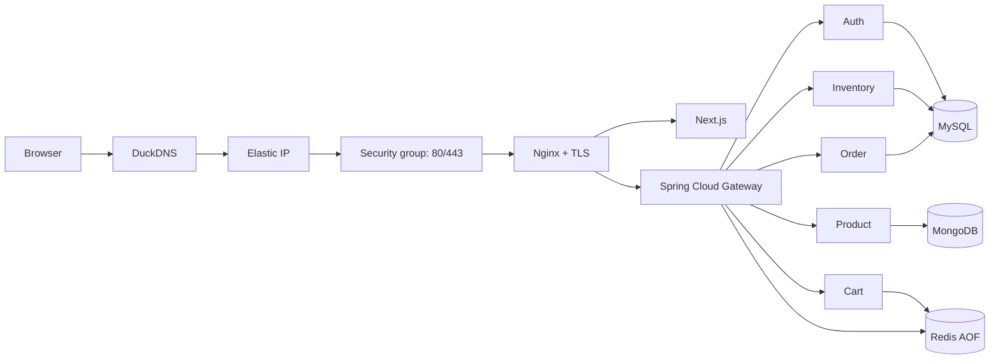

# ShopSphere Interview Guide

## Evidence boundary

Use this guide to describe what ShopSphere actually demonstrates. Do not turn planned work into a production claim.

| Area | Safe interview claim |
|---|---|
| Production application | Verified on one existing AWS EC2 instance in `ap-south-1`; HTTPS, Nginx health, products API, eleven application/data containers, and persistent MySQL/MongoDB/Redis volumes were checked on 2026-09-06. |
| AWS baseline | Existing `m7i-flex.large` instance `i-0e2cf0109097385b1`, Elastic IP `65.2.225.30`, encrypted 40 GiB gp3 root EBS `vol-0ed9fa47e65c3fd84`, IMDSv2 required, SSM administration, and only TCP 80/443 public. |
| CI | Run 34101039768 passed all checks and eight image publication gates after Phase 8 security fixes. |
| CD/OIDC | Approval-gated, exact-SHA, OIDC-to-SSM deployment and application rollback are configured in source. The AWS OIDC role/GitHub Environment and a successful workflow deployment have not yet been verified end to end. |
| Monitoring | Three monitoring containers, five dashboards, seven targets up and twelve rules verified. Host textfile metrics replaced cAdvisor. |
| Availability | This is a cost-conscious single-host portfolio deployment, not a highly available or horizontally scaled production platform. |
| Payments | Payment is simulated; ShopSphere is not a PCI-certified payment system. |

## Thirty-second architecture explanation

The browser reaches DuckDNS, a stable Elastic IP, and an AWS security group that allows only HTTP and HTTPS. Nginx terminates TLS, redirects HTTP, serves the Next.js storefront, and proxies API traffic to Spring Cloud Gateway. The Gateway handles routing, JWT policy, rate limits, timeouts, correlation IDs, circuit breakers, and safe read retries. Five Java 21 services own authentication, catalog, inventory, cart, and order workflows. MySQL stores users, inventory, and orders; MongoDB stores the catalog and related customer content; Redis stores carts and rate-limit state. Everything runs in Docker Compose on one EC2 host, with database ports private and persistent named volumes.

## Component ownership

| Component | Responsibility | Important design point |
|---|---|---|
| Nginx | Public TLS edge, HTTP redirect, frontend/API proxy, headers | Only component publishing host ports 80/443. |
| Next.js frontend | Customer storefront, account, product, cart, checkout, and order UI | Uses the same HTTPS origin and relative API path. |
| Gateway | API routing and cross-cutting policy | Keeps public entry policy out of each controller, while services still enforce sensitive authorization. |
| Auth Service | Registration, BCrypt login, JWTs, profile and addresses | MySQL with Flyway; BCrypt cost 12. |
| Product Service | Catalog, search, autocomplete, filters, details, reviews, wishlist | MongoDB supports flexible product documents and indexed queries. |
| Inventory Service | Available/reserved stock | MySQL transactions, locking/versioning, and no negative stock. |
| Cart Service | User-owned cart and server-resolved pricing | Redis AOF plus TTL; client prices are not trusted. |
| Order Service | Checkout, totals, address snapshot, history, idempotency | MySQL; resolves current product price and reserves inventory. |

## Core project questions

### Explain ShopSphere

ShopSphere is a portfolio-scale e-commerce platform that combines a real customer journey with production-oriented operations. A customer can authenticate, discover products, manage a cart, checkout with inventory controls, and view persisted orders. The project is deliberately honest about its scope: it demonstrates microservice, container, IaC, security, and operations practices on a cost-conscious single EC2 host; it does not claim multi-AZ availability or real payment processing.

### Why microservices?

They make ownership boundaries visible: authentication, catalog, inventory, cart, and orders have different data and consistency needs. They also let the project demonstrate routing, resilience, health checks, service-level persistence, and failure isolation. The trade-off is greater operational complexity, network failure modes, and distributed consistency. For a small commercial team, I would first consider a modular monolith and extract services only when independent scaling or ownership justified it.

### Why three data stores?

- MySQL fits users, inventory, orders, constraints, transactions, and Flyway migrations.
- MongoDB fits flexible catalog documents, specifications, search fields, reviews, and wishlist documents.
- Redis fits expiring cart aggregates and Gateway rate-limit counters; AOF improves restart persistence.

This is service-owned persistence, not a license for every service to query every database.

### Why both Nginx and Spring Cloud Gateway?

Nginx is the Internet-facing web edge: TLS, HTTP-to-HTTPS redirect, static/frontend proxying, request headers, body limits, compression, and basic security headers. The Gateway is the application edge: API route mapping, token/role policy, rate limiting, correlation IDs, circuit breakers, timeouts, and retry rules. Keeping these responsibilities distinct makes public web configuration and Java API policy independently understandable.

### Why Docker Compose instead of Kubernetes?

Compose matches the portfolio goal and budget: one EC2 host, eleven containers, private service discovery, health checks, restart policies, resource ceilings, and named volumes. Kubernetes would add control-plane and operational cost without solving a demonstrated scaling requirement. The limitation is explicit: a single host is one failure domain and Compose is not a high-availability scheduler.

### Why AWS and Terraform?

AWS provides the compute, durable block storage, stable public address, IAM, and SSM management plane. Terraform makes the VPC, subnet, Internet Gateway, route, security group, IAM profile, EC2 instance, EBS settings, and EIP reviewable as a dependency graph. The plan is the safety gate: it exposed AMI drift before an accidental EC2 replacement.

### Why SSM instead of SSH?

SSM avoids a public port 22 rule and long-lived SSH key distribution. The EC2 role carries `AmazonSSMManagedInstanceCore`; operators and the proposed deploy workflow target the known instance through AWS APIs. IAM authorization and auditability improve, although SSM availability and least-privilege IAM still need operational monitoring.

### How is checkout protected?

The browser sends product identity, quantity, shipping data, and an idempotency key. The Order Service resolves the current active product and authoritative price, calculates totals, reserves inventory, and persists the order and items. A durable unique idempotency record maps the key and intent to one order. Repeating the same completed request returns the existing order, while reusing the key with a different intent returns a conflict. A crash in a distributed transaction window still needs reconciliation; the implementation uses best-effort compensation rather than pretending it has a full Saga/outbox.

### How is data preserved during deployment?

MySQL, MongoDB, and Redis use named volumes. Production reconciliation uses `docker compose up -d --wait`; it never uses `docker compose down -v`. The environment and TLS material remain instance-local and Git-ignored. Application rollback changes Git/image revisions but never rewinds database data. Backward-incompatible schema changes therefore require a separately reviewed migration/recovery plan.

### What would you change for a higher-scale production system?

I would add multi-AZ compute or orchestration, managed databases and Redis, private application subnets, a managed load balancer/certificate path, centralized secrets, externalized logs/traces, external alert delivery, encrypted off-host backups with restore drills, asymmetric identity, an outbox/reconciliation workflow for orders, and measurable SLOs. I would add these from actual availability, scale, and compliance requirements rather than merely listing fashionable services.

## Backup and recovery questions

### What is the difference between backup and restore?

A backup is a recoverable copy created at a known time; restore is the tested procedure that reconstructs usable data. A dump file that has never been restored and compared is only a backup candidate. For ShopSphere, MySQL and MongoDB need application-aware dumps, while Redis AOF persistence and EBS protect different failure cases.

### What are RPO and RTO?

RPO is the maximum acceptable data-loss window. A daily backup implies up to roughly 24 hours of loss unless transaction logs or more frequent backups exist. RTO is the maximum acceptable time to restore service. Neither number should be invented: measure backup/restore duration and agree the business tolerance.

### Is the encrypted EBS volume a backup?

No. It preserves data across container recreation and instance stop/start, but it shares the instance/root-volume failure and deletion domain. A stronger design copies encrypted database backups to an independently controlled off-host destination such as S3 with lifecycle/versioning/access separation, then proves restoration regularly.

### How should ShopSphere test a restore safely?

Restore into isolated temporary database/schema/container names, compare row/document counts and representative records, verify permissions and application compatibility, and remove only the temporary test data afterward. Never overwrite live production merely to prove a restore. Phase 7 restored three MySQL databases/eleven tables and three MongoDB collections/43 documents into isolated containers; counts and record fingerprints matched.

### What is the disaster-recovery strategy today?

Today the verified controls are persistent named volumes on encrypted EBS and safe non-destructive deployment. That is persistence, not full disaster recovery. The intended progression is consistent MySQL/MongoDB dumps, tested isolated restores, encrypted off-host copies and retention, infrastructure recreation from Terraform, secret/certificate recovery, and a documented service recovery order. Recovery objectives must be measured after drills.

## What makes the project interview-worthy

1. It has a working customer system, not only infrastructure diagrams.
2. Infrastructure changes were stopped when Terraform proposed replacement.
3. Public exposure is intentionally limited to 80/443; administration uses SSM.
4. Persistence was tested across non-destructive container reconciliation and host restart.
5. HTTPS was migrated in place with a stable EIP, ACME webroot, non-root Nginx, and automated renewal.
6. CI/CD is designed around immutable SHA images, a vulnerability gate, approval, health verification, and application-only rollback.
7. Operational claims are evidence-based: configured, tested, deployed, and verified are treated as different states.

## Honest limitations to volunteer

- One EC2 host is a single point of failure.
- Databases share the host and root EBS failure domain.
- DuckDNS is appropriate for a portfolio demonstration, not the preferred commercial DNS design.
- Payment is simulated.
- Shared symmetric JWT, browser-local refresh storage, and Mongo administrator connectivity need improvement.
- Application rollback cannot undo destructive schema migrations.
- OIDC/SSM CD is source-configured but not yet proven by a successful workflow run.
- Monitoring is verified on the same host; external alert delivery and off-host telemetry remain absent.
- External alert delivery and off-host backup storage require separately approved credentials/services.

## Answering technique

For design questions, use: **requirement → choice → evidence → trade-off → next improvement**. For incidents, use STAR and include the safety decision: what you deliberately refused to destroy or expose. Never say “production-grade” without qualifying the single-host portfolio scope.
